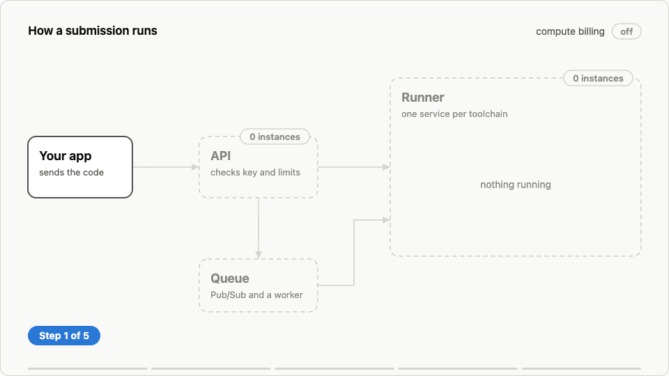
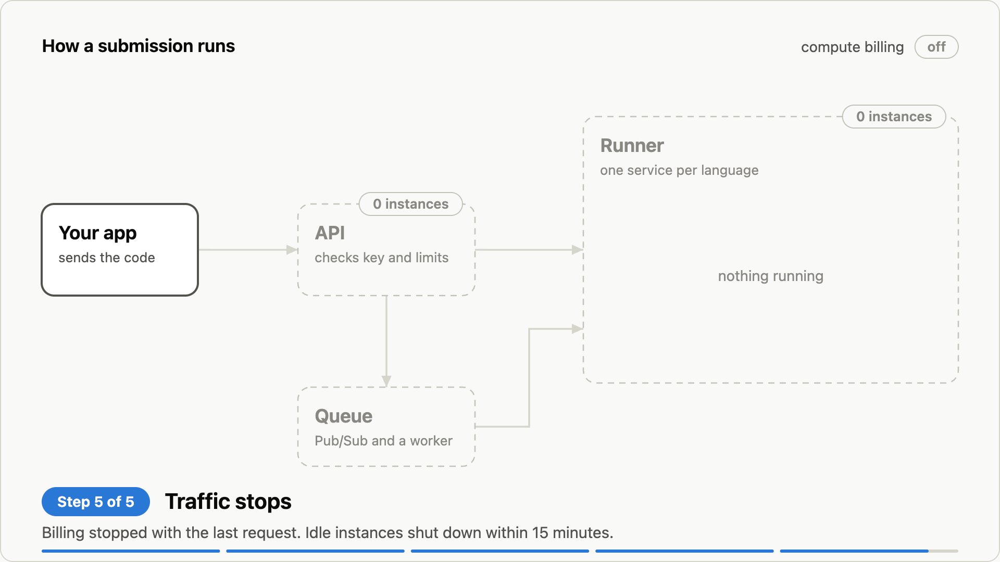
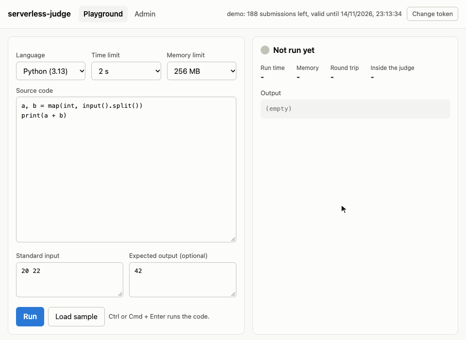

# serverless-judge

[](LICENSE)
[](docs/api.md)
[](docs/deploying.md)

**A code judge that costs nothing while nobody is using it.**

It speaks the [Judge0](https://ce.judge0.com) API, runs every submission in
its own throwaway sandbox, and lives entirely on Google Cloud Run. When the
last request finishes, everything scales back to zero and waits for the
next one.

<p align="center">
  <picture>
    <source media="(prefers-color-scheme: dark)" srcset="docs/how-it-works-dark.gif">
    
  </picture>
</p>

<details>
<summary><b>Too quick? Here are the same five steps as still pictures.</b></summary>
<br>

**1. Nobody is submitting.** Nothing is running, so there's no compute to
pay for.

<picture>
  <source media="(prefers-color-scheme: dark)" srcset="docs/steps/step-1-dark.png">
  
</picture>

**2. A submission arrives.** The API and the runner for that language
start on demand.

<picture>
  <source media="(prefers-color-scheme: dark)" srcset="docs/steps/step-2-dark.png">
  
</picture>

**3. It runs in its own sandbox.** No network, 2 s of CPU, 256 MB. One run,
then the sandbox is destroyed.

<picture>
  <source media="(prefers-color-scheme: dark)" srcset="docs/steps/step-3-dark.png">
  
</picture>

**4. A burst is queued.** Every submission gets a token at once. Runners
scale out and work through the queue.

<picture>
  <source media="(prefers-color-scheme: dark)" srcset="docs/steps/step-4-dark.png">
  
</picture>

**5. Traffic stops.** Billing stopped with the last request. Idle instances
shut down within 15 minutes.

<picture>
  <source media="(prefers-color-scheme: dark)" srcset="docs/steps/step-5-dark.png">
  
</picture>

</details>

## Why

Judge0 is the usual answer for running untrusted code, and it's a good one.
The catch is that it wants servers that are up all day and sized for your
busiest hour, while real traffic comes in bursts: a contest opens, a class
sits a test, and then it's quiet again.

I wanted the same API without paying for the quiet hours. Cloud Run now has
[sandboxes](https://docs.cloud.google.com/run/docs/code-execution), which
was the missing piece: every submission gets a fresh isolated box, and
Cloud Run takes care of starting and stopping the machines around it.

## What you get

- **The Judge0 API.** Same paths, fields, status ids and `X-Auth-Token`
  header. The few places it behaves differently are
  [written down](docs/api.md#differences-from-judge0).
- **Twelve languages.** C, C++, Python, JavaScript, TypeScript, Java, C#,
  Go, PHP, Rust, PostgreSQL and MySQL. Adding another is a folder with a
  Dockerfile and a JSON file.
- **A fresh sandbox for every submission.** gVisor, no network, no
  credentials, destroyed after one run.
- **Scale to zero.** No traffic means no instances. What's left is image
  storage, which comes to under 20 cents a month.
- **Bursts are fine.** Extra work queues up and the runners scale out. In a
  load test, 20,000 submissions sent in two minutes all came back with the
  right verdict.
- **Codeforces-style limits.** 2 s of CPU and 256 MB by default, 512 MB at
  most.
- **A playground and a dashboard.** Try any language in the browser, hand
  out temporary tokens, and watch latency and verdicts over time.
- **Nothing kept past 7 days.** Code, input and output expire on their own.
  Only anonymous counters stay, so the charts keep working.

## Quick start

You'll need a Google Cloud project with billing enabled, the
[gcloud CLI](https://cloud.google.com/sdk/docs/install) and
[Terraform](https://developer.hashicorp.com/terraform/install) 1.5 or newer.

```bash
gcloud auth login                         # used for the image builds
gcloud auth application-default login     # used by Terraform

cd terraform
terraform init
terraform apply -var project=<your-project-id>
```

The first apply takes about 11 minutes, and most of that is building
images. When it's done:

```bash
terraform output playground               # open this in a browser
$(terraform output -raw api_key_command)  # the key to paste into it
```

Would you rather not keep a Terraform state? `./deploy.sh all` gets you the
same thing with plain gcloud. Both are covered in
[docs/deploying.md](docs/deploying.md), along with how to add packages and
languages.

## Try it

The API serves its own playground at `/ui/`. Pick a language, press Run,
and you get the verdict, the output, the run time and the memory used.

<p align="center">
  <picture>
    <source media="(prefers-color-scheme: dark)" srcset="docs/playground-dark.gif">
    
  </picture>
</p>

That's a real session against a deployed copy, not a mock-up. "Round trip"
includes the network between the browser and the region.

Want someone else to try it? The admin page at `/ui/admin` makes temporary
tokens: give one a label, a lifetime (up to 7 days) and a cap on
submissions, and send the link. It opens the playground already signed in,
and the token can't do anything except submit and read results.

## Using the API

If you've used Judge0, you already know it.

```bash
export JUDGE_URL=$(terraform -chdir=terraform output -raw url)
export JUDGE_KEY=$($(terraform -chdir=terraform output -raw api_key_command))

# Run and wait for the result
curl -s "$JUDGE_URL/submissions?wait=true" -H "X-Auth-Token: $JUDGE_KEY" -H 'Content-Type: application/json' \
  -d '{"language_id": 71, "source_code": "print(int(input()) * 2)", "stdin": "21", "expected_output": "42"}'

# Or queue it and poll
curl -s "$JUDGE_URL/submissions" -H "X-Auth-Token: $JUDGE_KEY" -H 'Content-Type: application/json' \
  -d '{"language_id": 54, "source_code": "..."}'            # -> {"token": "..."}
curl -s "$JUDGE_URL/submissions/<token>" -H "X-Auth-Token: $JUDGE_KEY"
```

| Language | ids | | Language | ids |
|---|---|---|---|---|
| C (GCC 14) | 50, 103 | | Go 1.26 | 60, 107 |
| C++ (GCC 14, C++20) | 54, 105 | | PHP 8.4 | 68, 98 |
| Python 3.13 | 71, 100 | | Rust (stable) | 73, 108 |
| JavaScript (Node 24) | 63, 102 | | C# (.NET 10) | 51 |
| TypeScript 7 | 74, 101 | | PostgreSQL 18 | 201 |
| Java 25 | 62, 91 | | MySQL 8.4 | 202 |

Batches, base64, callbacks, extra files and compiler options work too. The
full list is in [docs/api.md](docs/api.md).

## How it works

Four pieces, all on Cloud Run:

- **judge-api** is the public front door. It checks the request, stores it,
  and compares the output to decide the verdict. Expected output never
  goes near a sandbox.
- **runner-\<language\>** is one service per toolchain. Each instance takes
  one job at a time and runs it in a sandbox that it throws away
  afterwards.
- **A queue** (Pub/Sub) holds whatever doesn't need an answer right away.
- **judge-worker** drains the queue, so a backlog can't starve the callers
  who are waiting on the API.

```
                      wait=true
client ─X-Auth-Token─> judge-api ───────────────────────────┐
                         │ wait=false                       ▼
                         └─> Pub/Sub ─push─> judge-worker ─> runner-<family> ─ sandbox ─ your program
                Firestore: submissions, language registry
```

[docs/architecture.md](docs/architecture.md) goes through each part, the
safety measures and what is stored for how long.

## How fast is it

A warm Python run takes 30 to 50 ms inside the runner, C about 100 to
200 ms, Java around half a second, and C++ with `<bits/stdc++.h>` about a
second. A cold start takes roughly 1 to 4 seconds depending on the
language.

With the default quota of 200 vCPU the ceiling is about 135 submissions per
second across all twelve languages. Past that, work queues: 20,000
submissions sent at 167 per second all finished with the right verdict.

The numbers, how they were measured, and what to change when you need more
are in [docs/performance.md](docs/performance.md).

## What it costs

| | You pay for |
|---|---|
| While code is running | Cloud Run time on the runner (2 vCPU, 2 GiB) and the API, for as long as the run lasts. A 20,000-submission load test came to about $0.67. |
| While idle | Image storage: 11 to 18 cents a month. Everything else rounds to zero. |

These are estimates from list prices, not a bill. The breakdown and the
size of every image are in [docs/cost.md](docs/cost.md).

## Is it safe

Running strangers' code is the whole job, so:

- Every program runs in a gVisor sandbox with no network, no metadata
  server, an empty environment and a read-only filesystem apart from an
  in-memory `/tmp`.
- One job per sandbox, one request per instance.
- The runners have a service account with no roles, and only the API may
  call them.
- CPU, wall time, memory, output size, file size, process count and disk
  growth are all capped.

One caveat you should know about: Cloud Run sandboxes are in **public
preview**, so there's no SLA and behaviour may change.
[docs/architecture.md](docs/architecture.md#safety) has the details and the
fallback.

## Docs

- [Deploying](docs/deploying.md): Terraform, `deploy.sh`, adding packages
  and languages
- [API](docs/api.md): endpoints, language ids, differences from Judge0,
  temporary tokens
- [Architecture](docs/architecture.md): the parts, safety, data retention,
  known gaps
- [Performance and capacity](docs/performance.md): timings, the CPU quota,
  load tests
- [Cost](docs/cost.md): running and idle cost, image sizes

## Development

```bash
(cd runner && go test ./...)                 # supervisor logic, sandbox pool
(cd api && go test ./...)                    # limits, verdicts, grouping, dispatch
JUDGE_URL=... JUDGE_KEY=... python3 tests/e2e.py       # every language and verdict, live
JUDGE_URL=... JUDGE_KEY=... python3 tests/burst.py 300 # a spike
JUDGE_URL=... JUDGE_KEY=... go run tests/loadtest/main.go -n 20000 -duration 2m   # sustained load
```

`tests/loadtest` submits different programs at a steady rate, about 5% of
them built to fail in a known way, and passes only if every one gets
exactly the verdict it should. Check your quota before running it at a new
rate.

`docs/render.js` regenerates the pictures in this README: the animation and
its stills from `docs/how-it-works.html`, and the playground recording from
a live session.

`probe/` holds a debug shell that can be deployed on top of any runner
image (`probe/on.sh <family>`). It executes arbitrary commands, so it's
IAM-protected and should be deleted after use:
`gcloud run services delete judge-probe --region <region>`.

## Limitations

- Cloud Run sandboxes are a preview feature.
- A queued job can occasionally run twice, because Pub/Sub delivers at
  least once. The result is the same either way.
- Stored output is cut off at 1 MiB (a Firestore document). `wait=true`
  callers still get all of it.
- Admin keys have no rate limit. Temporary tokens have a submission cap but
  no rate limit either.
- Instance caps are per language, so a spike in one can't borrow capacity
  another isn't using.

The longer list is in
[docs/architecture.md](docs/architecture.md#known-gaps).

## License

[MIT](LICENSE)
