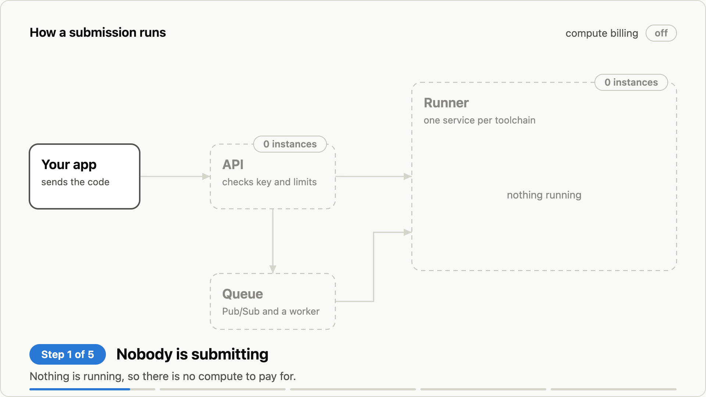
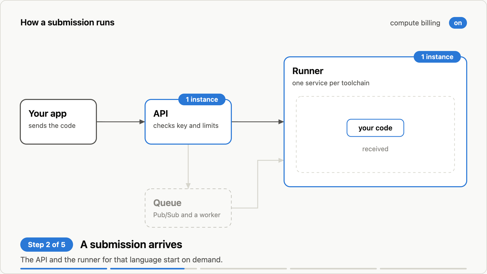
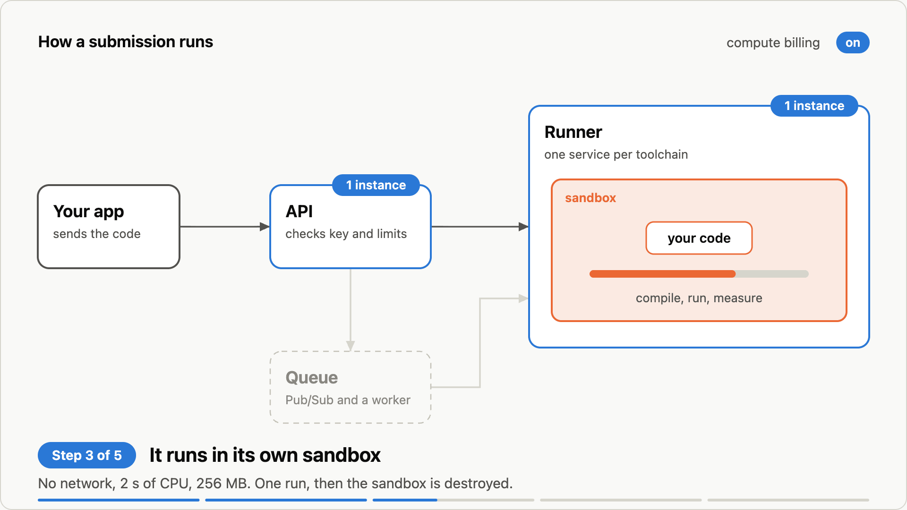
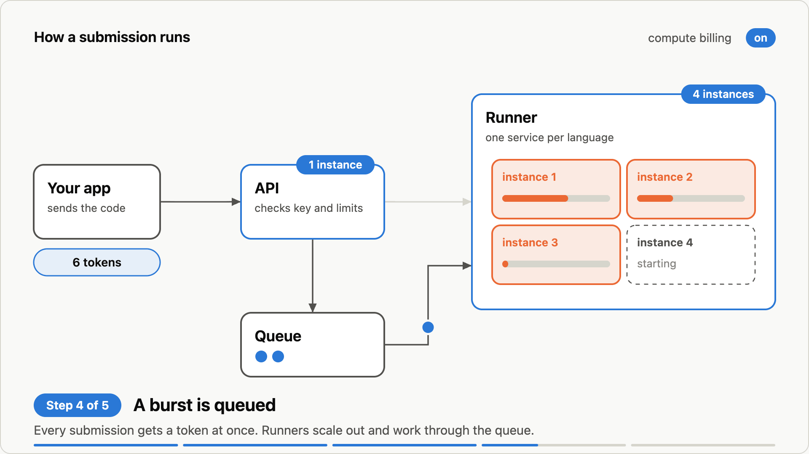

# serverless-judge

[](LICENSE)
[](docs/api.md)
[](docs/deploying.md)

**A pure Serverless code judge.**

I've been using [Judge0](https://ce.judge0.com) extensively for our code execution needs. It's cool and fast, but the requirement for an always-on server, Redis, PostgreSQL, and workers makes it rather expensive to adopt for smaller projects and organizations.

So, I've been working on something similar that aims to be just as fast while significantly reducing costs and handling generous traffic spikes (20K submissions in 2 minutes for approximately $0.67).

Google Cloud Run seems like a fascinating option because of its ability to scale up quickly and scale down to zero when idle. Essentially, it's a pay-as-you-code Judge!

I've included the load-testing statistics below so you can estimate the cost for your own use case.

It runs on Cloud Run sandboxes, making it extremely secure while requiring virtually zero maintenance.

(At least until an AGI tries to hack it. 😉)

Let me know if you're looking forward to using or improving it. I would like to learn how it's being used and how it can be improved.

Its API is the same as [Judge0](https://ce.judge0.com)'s, it runs every submission in its own secure throwaway sandbox, and it lives entirely on Google Cloud Run. It scales to 0 when not in use, and starting from nothing it has worked through a burst of 1,000 Python submissions in 29 seconds. Once it's warm, it keeps up with about 135 submissions per second on Google's default quota.

**Here are the simple five steps to understand it quickly.**

**1. Nobody is submitting.** Nothing is running at this point, so there's
no compute to pay for.

<picture>
  <source media="(prefers-color-scheme: dark)" srcset="docs/steps/step-1-dark.png">
  
</picture>

**2. A submission arrives.** The API wakes up, and so does the runner for
that language. Nothing else starts.

<picture>
  <source media="(prefers-color-scheme: dark)" srcset="docs/steps/step-2-dark.png">
  
</picture>

**3. The code runs in its own sandbox.** It gets no network, 2 seconds of
CPU and 256 MB of memory. The sandbox is used for that one run and then
destroyed.

<picture>
  <source media="(prefers-color-scheme: dark)" srcset="docs/steps/step-3-dark.png">
  
</picture>

**4. A burst comes in.** Every submission gets a token straight away, so
nobody is turned away. The extra work waits in a queue while more runners
start and work through it.

<picture>
  <source media="(prefers-color-scheme: dark)" srcset="docs/steps/step-4-dark.png">
  
</picture>

**5. Traffic stops.** Billing stops with the last request, and the idle
instances shut down on their own within 15 minutes.

<picture>
  <source media="(prefers-color-scheme: dark)" srcset="docs/steps/step-5-dark.png">
  
</picture>

## What you get

I wanted this to be a drop-in replacement, so most of the list below will
look familiar if you've run Judge0 before.

- **The Judge0 API.** The paths, the fields, the status ids and the
  `X-Auth-Token` header are all the same, so an existing client should
  only need a new URL and key. There are a few places where it behaves
  differently, and I've
  [written them down](docs/api.md#differences-from-judge0).
- **Twelve languages.** C, C++, Python, JavaScript, TypeScript, Java, C#,
  Go, PHP, Rust, PostgreSQL and MySQL. If yours is missing, adding one is
  a folder with a Dockerfile and a JSON file.
- **A fresh sandbox for every submission.** Each run gets its own gVisor
  sandbox with no network and no credentials, and that sandbox is
  destroyed as soon as the run is over.
- **Scale to zero.** When there's no traffic, there are no instances. The
  only thing left on the bill is image storage, which comes to under 20
  cents a month.
- **Room for bursts.** When more work arrives than the runners can take,
  it queues up while they scale out. In my load test, 20,000 submissions
  sent in two minutes all came back with the right verdict.
- **Codeforces-style limits.** A submission gets 2 seconds of CPU and
  256 MB of memory by default, and 512 MB is the most it can ask for.
- **A playground and a dashboard.** You can try any language in the
  browser, hand out temporary tokens to other people, and watch latency
  and verdicts over time.
- **Nothing kept past 7 days.** Code, input and output expire on their
  own. Only anonymous counters stay behind, so the charts keep working
  after the data is gone.

## Quick start

You'll need a Google Cloud project with billing enabled, the
[gcloud CLI](https://cloud.google.com/sdk/docs/install) and
[Terraform](https://developer.hashicorp.com/terraform/install) 1.5 or
newer. With those in place, the whole thing is one apply:

```bash
gcloud auth login                         # used for the image builds
gcloud auth application-default login     # used by Terraform

cd terraform
terraform init
terraform apply -var project=<your-project-id>
```

The first apply takes about 11 minutes, and most of that is spent building
images. Once it finishes, these two commands give you the playground and
the key to sign in with:

```bash
terraform output playground               # open this in a browser
$(terraform output -raw api_key_command)  # the key to paste into it
```

If you'd rather not keep a Terraform state, `./deploy.sh all` gets you the
same result with plain gcloud. I've covered both in
[docs/deploying.md](docs/deploying.md), along with how to add packages and
languages.

## Try it

The API serves its own playground at `/ui/`. You pick a language, press
Run, and get back the verdict, the output, the run time and the memory
used.

<p align="center">
  <picture>
    <source media="(prefers-color-scheme: dark)" srcset="docs/playground-dark.gif">
    
  </picture>
</p>

That recording is a real session against a deployed copy, not a mock-up.
The "round trip" figure includes the network between the browser and the
region, which is why it's larger than the run time.

If you want someone else to try it, the admin page at `/ui/admin` makes
temporary tokens. You give one a label, a lifetime of up to 7 days and a
cap on submissions, and then send the link. It opens the playground
already signed in, and the token can't do anything except submit and read
results.

## Using the API

If you've used Judge0, you already know it. Here is a run that waits for
its result, followed by the queue-and-poll version of the same thing:

```bash
export JUDGE_URL=$(terraform -chdir=terraform output -raw url)
export JUDGE_KEY=$($(terraform -chdir=terraform output -raw api_key_command))

# Run and wait for the result
curl -s "$JUDGE_URL/submissions?wait=true" -H "X-Auth-Token: $JUDGE_KEY" -H 'Content-Type: application/json' \
  -d '{"language_id": 71, "source_code": "print(int(input()) * 2)", "stdin": "21", "expected_output": "42"}'

# Or queue it and poll
curl -s "$JUDGE_URL/submissions" -H "X-Auth-Token: $JUDGE_KEY" -H 'Content-Type: application/json' \
  -d '{"language_id": 54, "source_code": "..."}'            # -> {"token": "..."}
curl -s "$JUDGE_URL/submissions/<token>" -H "X-Auth-Token: $JUDGE_KEY"
```

The language ids are the ones Judge0 uses, so you can keep the ones you
already have:

| Language | ids | | Language | ids |
|---|---|---|---|---|
| C (GCC 14) | 50, 103 | | Go 1.26 | 60, 107 |
| C++ (GCC 14, C++20) | 54, 105 | | PHP 8.4 | 68, 98 |
| Python 3.13 | 71, 100 | | Rust (stable) | 73, 108 |
| JavaScript (Node 24) | 63, 102 | | C# (.NET 10) | 51 |
| TypeScript 7 | 74, 101 | | PostgreSQL 18 | 201 |
| Java 25 | 62, 91 | | MySQL 8.4 | 202 |

Batches, base64, callbacks, extra files and compiler options work as well.
The full list is in [docs/api.md](docs/api.md).

## How it works

There are four pieces and no servers to look after:

- **judge-api** is the public front door. It checks the request, stores
  it, and decides the verdict by comparing the output with what was
  expected. The expected output never goes near a sandbox, so a program
  has no way to read the answer.
- **runner-\<language\>** is one service per toolchain. Each instance
  takes one job at a time and runs it in a sandbox that it throws away
  afterwards.
- **A queue** (Pub/Sub) holds whatever doesn't need an answer right away.
- **judge-worker** drains that queue. I kept it separate from the API so
  that a backlog can't starve the callers who are waiting on a response.

```
                      wait=true
client ─X-Auth-Token─> judge-api ───────────────────────────┐
                         │ wait=false                       ▼
                         └─> Pub/Sub ─push─> judge-worker ─> runner-<family> ─ sandbox ─ your program
                Firestore: submissions, language registry
```

[docs/architecture.md](docs/architecture.md) goes through each part in
more detail, along with the safety measures and what is stored for how
long.

## How fast is it

A warm Python run takes 30 to 50 ms inside the runner. C takes about 100
to 200 ms, Java around half a second, and C++ with `<bits/stdc++.h>` about
a second. A cold start takes roughly 1 to 4 seconds, depending on the
language.

With Google's default quota of 200 vCPU per region, the ceiling I measured
is about 135 submissions per second across all twelve languages. Anything
past that waits in the queue instead of failing: when I sent 20,000
submissions at 167 per second, every one of them finished with the right
verdict.

The numbers, how I measured them, and what to change when you need more
are in [docs/performance.md](docs/performance.md).

## What it costs

This is the part I cared about most, and these are the statistics I
promised at the top.

| | You pay for |
|---|---|
| While code is running | Cloud Run time on the runner (2 vCPU, 2 GiB) and the API, for as long as the run lasts. A 20,000-submission load test came to about $0.67. |
| While idle | Image storage: 11 to 18 cents a month. Everything else rounds to zero. |

That load test works out to roughly 3 cents per thousand submissions for
its mix of languages, which should be enough to size your own use case.
Bear in mind that these are estimates from list prices, not a bill. The
breakdown and the size of every image are in [docs/cost.md](docs/cost.md).

## Is it safe

Running strangers' code is the whole job, so this is where most of the
care went:

- Every program runs in a gVisor sandbox with no network, no metadata
  server, an empty environment and a read-only filesystem apart from an
  in-memory `/tmp`.
- There is one job per sandbox and one request per instance, so two
  submissions are never running side by side on the same machine.
- The runners use a service account with no roles at all, and only the
  API is allowed to call them.
- CPU, wall time, memory, output size, file size, process count and disk
  growth are all capped.

There's one caveat you should know about before you depend on it. Cloud
Run sandboxes are in **public preview**, which means there's no SLA and
the behaviour may change.
[docs/architecture.md](docs/architecture.md#safety) has the details and
the fallback.

## Docs

The longer explanations live in the `docs` folder:

- [Deploying](docs/deploying.md): Terraform, `deploy.sh`, adding packages
  and languages
- [API](docs/api.md): endpoints, language ids, differences from Judge0,
  temporary tokens
- [Architecture](docs/architecture.md): the parts, safety, data retention,
  known gaps
- [Performance and capacity](docs/performance.md): timings, the CPU quota,
  load tests
- [Cost](docs/cost.md): running and idle cost, image sizes

## Development

The unit tests only need Go. The other three run against a deployed copy,
so they need its URL and key:

```bash
(cd runner && go test ./...)                 # supervisor logic, sandbox pool
(cd api && go test ./...)                    # limits, verdicts, grouping, dispatch
JUDGE_URL=... JUDGE_KEY=... python3 tests/e2e.py       # every language and verdict, live
JUDGE_URL=... JUDGE_KEY=... python3 tests/burst.py 300 # a spike
JUDGE_URL=... JUDGE_KEY=... go run tests/loadtest/main.go -n 20000 -duration 2m   # sustained load
```

`tests/loadtest` submits different programs at a steady rate, with about
5% of them built to fail in a known way, and it passes only if every one
gets exactly the verdict it should. Check your quota before running it at
a new rate.

`docs/render.js` regenerates the pictures in this README: the five stills
(and an animated version of them) from `docs/how-it-works.html`, and the
playground recording from a live session.

`probe/` holds a debug shell that can be deployed on top of any runner
image (`probe/on.sh <family>`). It executes arbitrary commands, so it's
IAM-protected and should be deleted after use:
`gcloud run services delete judge-probe --region <region>`.

## Contributing

I'd like to hear how you're using it, what broke and what's missing, so
issues and pull requests are welcome. [CONTRIBUTING.md](CONTRIBUTING.md)
explains how to run the tests and what I look for in a change, and the
[code of conduct](CODE_OF_CONDUCT.md) applies to everyone taking part.

If you've found a way out of the sandbox, or any other security problem,
please don't open a public issue. [SECURITY.md](SECURITY.md) says how to
report it privately.

## Limitations

A few things you should know before relying on it:

- Cloud Run sandboxes are a preview feature, as mentioned above.
- A queued job can occasionally run twice, because Pub/Sub delivers at
  least once. The result is the same either way.
- Stored output is cut off at 1 MiB, which is the size of a Firestore
  document. Callers using `wait=true` still get all of it.
- Admin keys have no rate limit. Temporary tokens have a cap on
  submissions, but no rate limit either.
- Instance caps are per language, so a spike in one language can't borrow
  the capacity another isn't using.

The longer list is in
[docs/architecture.md](docs/architecture.md#known-gaps).

## License

[MIT](LICENSE)
